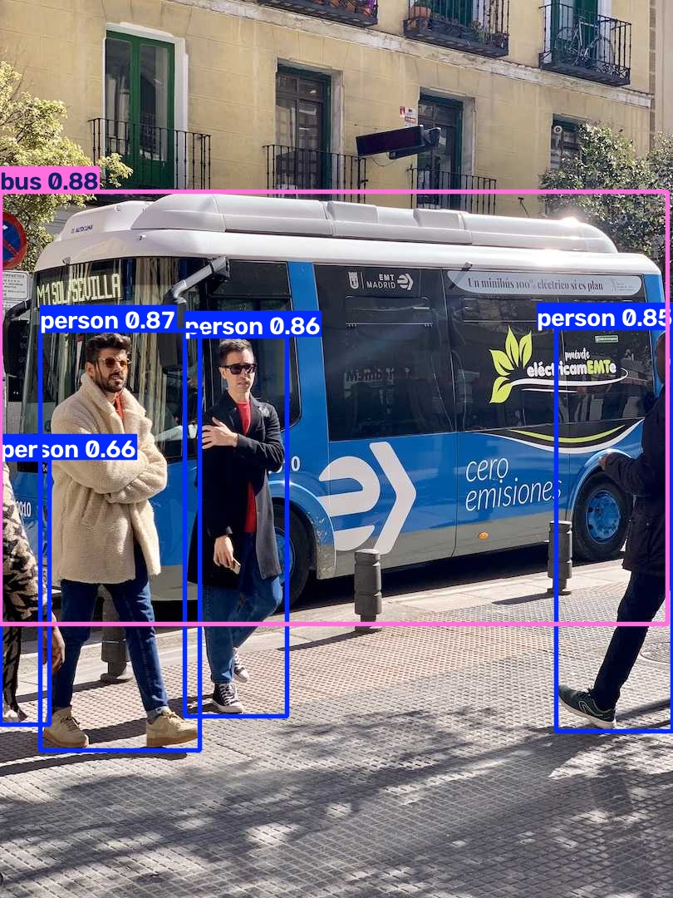
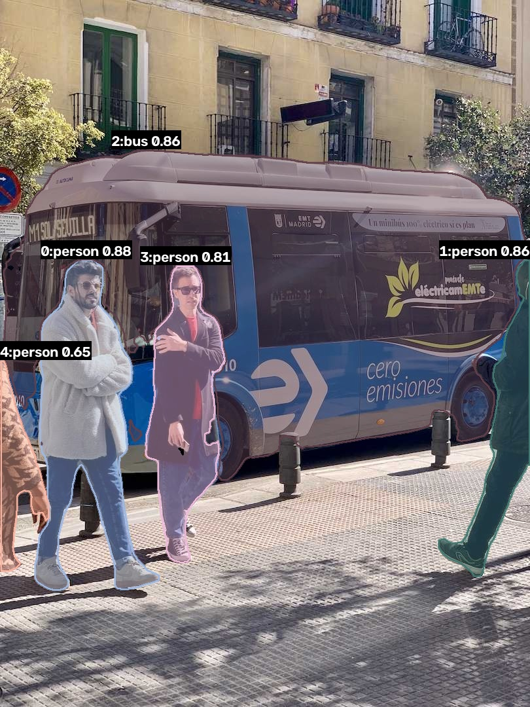
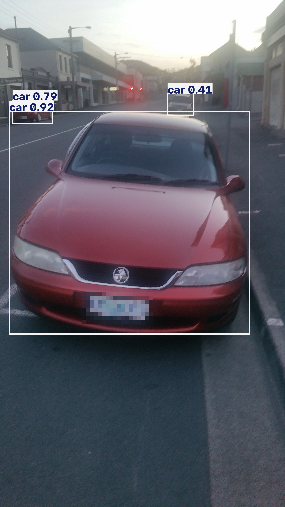
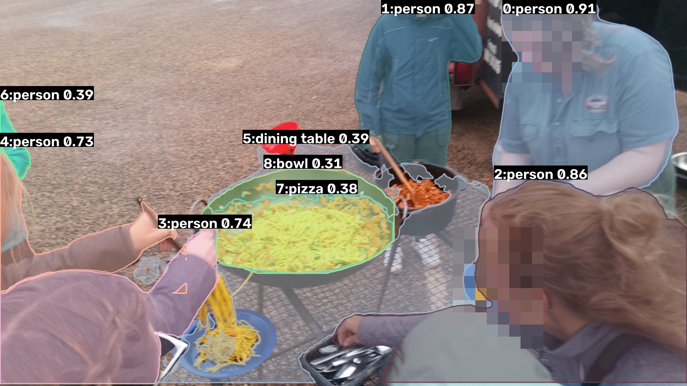
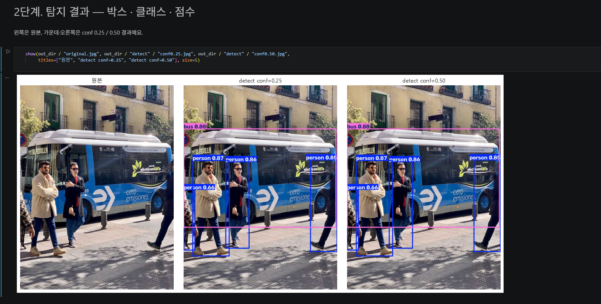
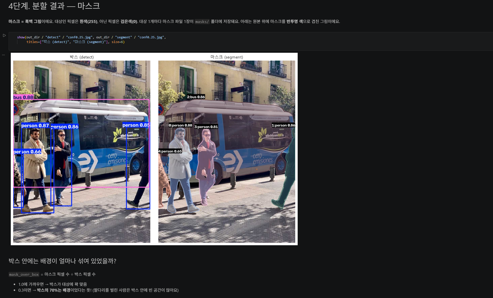
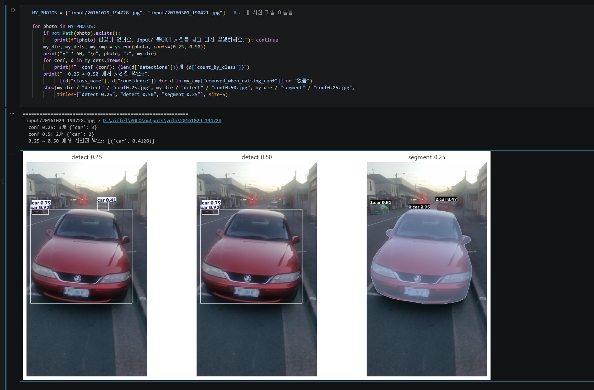

# 과제 A. YOLO 서비스 — 탐지(박스)와 분할(마스크) 비교

사진을 넣으면 **탐지 결과(박스·클래스·점수)**와 **분할 결과(마스크)**를 conf 0.25와 0.50으로 나란히 보여 주고, 결과를 이미지·JSON·마스크 파일로 저장하는 노트북 서비스입니다.

- 📓 **노트북:** [`yolo_service.ipynb`](yolo_service.ipynb) (GitHub에서 안 열리면 nbviewer에 이 파일 주소를 넣어 주세요: https://nbviewer.org)
- 🧠 **핵심 코드:** [`yolo_service.py`](yolo_service.py) · 확인용 확대 그림: [`make_checks.py`](make_checks.py)

| 버스 예제 — 탐지 (conf 0.25) | 버스 예제 — 분할 (conf 0.25) |
|---|---|
|  |  |

| 자동차 사진 — 탐지 (conf 0.25) | 야외 요리 사진 — 분할 (conf 0.25) |
|---|---|
|  |  |

> 직접 찍은 사진 2장은 **얼굴·번호판을 모자이크**한 결과만 올렸습니다. 원본은 저장소에 포함하지 않았습니다.

## 서비스 화면 캡처
로컬 JupyterLab에서 노트북을 실행한 화면입니다. 코드 셀과 그 실행 결과가 함께 보입니다.

**① 2단계: 사진을 넣으면 박스가 나온다 (원본 / conf 0.25 / conf 0.50)**


**② 4단계: 같은 사진의 탐지(박스)와 분할(마스크) 비교**


**③ 5단계: 내 사진(자동차)으로 실행. conf 0.50에서 멀리 있는 흰 차(0.41)가 사라짐**


---

## 1. 실행 위치와 환경
| 항목 | 값 |
|---|---|
| 실행 위치 | 로컬 PC (Windows 11) |
| 장치 | CPU (`device=cpu`) |
| 입력 크기 | `imgsz=640` |
| 파이썬 | 3.14, 가상환경 `.venv` (전역 파이썬에는 설치하지 않음) |
| 주요 패키지 | ultralytics 8.4.208, torch 2.15.0 (CPU), opencv-python 5.0.0 → [`requirements.txt`](requirements.txt) |
| 모델 | `models/yolo26n.pt` (detect), `models/yolo26n-seg.pt` (segment), COCO 80개 클래스 |

사진마다 실행 기록이 `outputs/yolo/<사진이름>/manifest.json`에 남습니다. 입력 파일, 모델·패키지 버전, 실행 위치, 설정이 들어 있습니다.

## 2. 실행 방법
```bash
# 1) 가상환경 만들기 (처음 한 번)
python -m venv .venv
.venv/Scripts/python.exe -m pip install -r requirements.txt
.venv/Scripts/python.exe -m ipykernel install --user --name yolo-venv --display-name "Python (YOLO .venv)"

# 2-a) 노트북으로 보기 (커널: Python (YOLO .venv))
.venv/Scripts/python.exe -m jupyter lab yolo_service.ipynb

# 2-b) 명령줄로 결과만 저장 (여러 장 가능)
.venv/Scripts/python.exe yolo_service.py input/bus.jpg --conf 0.25 0.50
.venv/Scripts/python.exe make_checks.py
```
- 모델 파일이 없으면 첫 실행 때 `models/`에 자동으로 내려받습니다.
- 개인 사진 원본은 저장소에 없습니다. 그래서 노트북 5단계를 다시 실행하면 "파일이 없어요"가 나옵니다. 결과는 노트북에 저장된 출력과 `outputs/`에서 확인할 수 있습니다.

## 3. 도구와 설정을 고른 이유
| 선택 | 이유 |
|---|---|
| **탐지 + 분할 두 모델** | 같은 사진에서 "어디 있나(박스)"와 "어디까지인가(마스크)"가 어떻게 다른지 비교하려고 |
| **관찰 대상: person, car, bus** | 세 사진에 공통으로 많이 나오고, 원본에서 정답을 사람이 바로 셀 수 있는 대상이라서 |
| **conf 0.25와 0.50** | 커트라인을 올리면 무엇이 사라지는지(오탐이 줄어드는지, 진짜를 놓치는지) 보려고 |
| **conf 0.05 추가 확인 (구경용)** | bus 사진은 0.25와 0.50 결과가 같아서, 0.25 아래에 어떤 후보가 숨어 있었는지 보려고 |
| **CPU · imgsz 640** | 과제에서 정한 설정. GPU 없이도 누구나 같은 결과를 재현할 수 있음 |
| **노트북** | 설명, 실행, 결과 그림, 관찰 기록을 한 화면에 함께 남길 수 있어서 |
| **마스크를 원본 크기 픽셀 그대로 저장** (`retina_masks=True`) | 넓이(픽셀 수)를 원본 기준으로 정확히 세려고. 아래 5번의 수정 기록 참고 |

## 4. 결과 요약 (`outputs/yolo/summary.json`)
| 사진 | 탐지 conf 0.25 | 탐지 conf 0.50 | 0.50에서 사라진 박스 |
|---|---|---|---|
| bus (예제) | bus 1, person 4 | bus 1, person 4 | 없음 (최저 점수 0.656) |
| 자동차 | car 3 | car 2 | car 0.41 (멀리 있는 흰 차) |
| 야외 요리 | person 8, dining table 1, cell phone 1, bowl 1 | person 4, dining table 1 | person 0.49·0.37·0.36·0.25, cell phone 0.38, bowl 0.30 |

## 5. 원본 대조 기록
확대 그림은 각 사진의 `checks/` 폴더에 있고, 노트북 3단계·4단계·5-1단계에 자세한 기록이 있습니다.

| 사진 | 종류 | 무엇이 틀렸나 | 위치 (원본 픽셀) | 확인 그림 |
|---|---|---|---|---|
| bus | 오탐 (0.25에서 걸러짐) | 주차금지 표지판을 `stop sign 0.13`으로 봄 | x 0~35, y 252~326 | [보기](outputs/yolo/bus/checks/stop_sign_false_positive.jpg) |
| bus | 마스크 누락 | 선글라스 쓴 사람의 휴대폰 쥔 손 아래 코트 부분에 구멍 (11×14px) | x 271~282, y 683~697 | [보기](outputs/yolo/bus/checks/phone_missing_from_mask.jpg) |
| 자동차 | **미탐 (conf 0.50)** | 멀리 있는 흰 차(진짜 차)가 0.41점이라 0.50에서 사라짐 | x 1757~2032, y 982~1206 | [보기](outputs/yolo/20161029_194728/checks/far_car_conf025_vs_conf050_vs_mask.jpg) |
| 자동차 | 마스크 과다 | 같은 차의 마스크가 차체 오른쪽 배경까지 칠함 (분할 박스 x 2096 vs 탐지 박스 x 2032) | x 2032~2096 부근 | (위와 같은 그림) |
| 야외 요리 | 오탐 | 수저통을 `cell phone 0.38`로 봄 | x 2302~3064, y 2542~2988 | [보기](outputs/yolo/20180309_190421/checks/tray_as_cell_phone.jpg) |
| 야외 요리 | 오탐 (클래스 없음) | 면을 `pizza 0.38`, 웍을 `bowl 0.31`로 봄 (분할) | 웍 주변 | [보기](outputs/yolo/20180309_190421/checks/wok_as_pizza_and_bowl.jpg) |
| 야외 요리 | **미탐 (conf 0.50)** | 뒤통수만 보이는 사람(0.49), 왼쪽 끝 청록색 옷 사람(0.36)이 0.50에서 사라짐 | 왼쪽 아래·왼쪽 끝 | [보기](outputs/yolo/20180309_190421/checks/left_people_conf025_vs_conf050.jpg) |
| 야외 요리 | ⚠️ 확인 필요 | 두 사람 사이의 좁은 박스 `person 0.37`. 별도 사람이 안 보여 중복·오탐으로 추정 | x 3589~4018, y 2~866 | [보기](outputs/yolo/20180309_190421/checks/narrow_person_box_between_two.jpg) |
| 야외 요리 | ⚠️ 확인 필요 | `person 0.25`가 `person 0.53` 박스와 대부분 겹침. 같은 사람의 중복으로 추정 | x 2~1402, y 1177~2269 | — |

**정리:** conf를 0.50으로 올리면 오탐(수저통, 냄비)은 줄지만, **가장자리에 잘리거나 멀리 있는 진짜 대상(사람, 차)도 함께 사라졌습니다.** "몇 명·몇 대인가"를 세는 일이라면 0.50은 놓치는 대상이 생기는 커트라인입니다.

## 6. 한계와 처리 범위
- **클래스 한계:** COCO 80개 클래스만 알아봅니다. 면 요리, 웍, 냄비처럼 목록에 없는 물체는 가장 비슷한 이름(pizza, bowl)으로 잘못 답합니다.
- **모델 크기:** `n`(nano)은 가장 작은 모델이라 가는 부분, 멀고 흐린 물체에서 마스크 경계가 거칩니다. 이 마스크로 넓이를 재면 오차가 생길 수 있습니다.
- **점수의 의미:** confidence는 후보의 우선순위일 뿐 "맞을 확률"이 아닙니다. 탐지 모델과 분할 모델은 같은 물체에도 다른 점수를 줍니다 (예: 흰 차 0.41 vs 0.47).
- **정답 기준:** 오탐·미탐 판단은 제가 원본을 눈으로 보고 한 것입니다. 정답 라벨이 없어서 정밀도·재현율 같은 수치는 계산하지 않았습니다.
- **확인 필요로 남긴 것:** 위 표의 ⚠️ 2건은 원본만으로 확정하기 어려워 추측으로 채우지 않았습니다.
- **수정 기록:** 처음에는 마스크를 윤곽선(다각형)으로 다시 칠해 저장했습니다. 그런데 bus 사진의 털코트 사람 마스크에 **몸을 가로지르는 가는 직선**이 생겼습니다. 모델이 아니라 저장 방식이 만든 흔적이어서, 모델이 낸 픽셀 마스크를 원본 크기 그대로 저장하는 방식(`retina_masks=True`)으로 바꿨습니다. 바꾼 뒤 직선이 사라진 것을 확인했습니다.

## 7. 처음 예상한 오류와 실제 결과
**처음 예상:** 사람이 겹친 곳에서 박스가 하나로 합쳐질 것이라 예상했다.

**실제 결과:**
- **겹친 곳: 예상과 반대였다.** 박스가 합쳐지지 않았고, 오히려 **하나가 더 생겼다.** 야외 요리 사진에서 파란 재킷과 초록 셔츠 사람 사이에 사람이 없는데 좁은 `person 0.37` 박스가 생겼다. 왼쪽 사람에게도 `person 0.53`과 거의 겹치는 `person 0.25`가 따로 생겼다. bus 사진에서는 겹쳐 선 사람들이 각각 따로 잘 잡혔다.
- **예상하지 못한 곳에서 문제가 생겼다.** 점수가 낮아 conf 0.50에서 사라진 것은 겹친 사람이 아니었다. **사진 가장자리에 잘린 사람**(왼쪽 끝 청록색 옷 0.36), **뒤통수만 보이는 사람**(0.49), **멀리 있는 흐린 차**(0.41)였다. 모두 진짜 대상이라 0.50에서는 미탐이 된다.
- **전혀 예상하지 못한 오류도 있었다.** 모델이 배운 적 없는 물체는 비슷한 다른 이름으로 답했다. 수저통은 `cell phone`, 면은 `pizza`, 웍과 냄비는 `bowl`이 됐다. 겹침보다 **"모델이 아는 클래스 목록에 그 물체가 있는가"**가 더 큰 오류 원인이었다.

**배운 점:** 오류는 대상이 겹친 정도보다 **대상이 얼마나 잘 보이는지**(잘림, 뒷모습, 거리)와 **모델이 그 물체를 배웠는지**에 더 크게 좌우됐다. 그래서 conf를 정할 때는 업무에서 무엇이 더 위험한지 먼저 정해야 한다. 놓치는 게 위험한 일(사람 수 세기)이라면 0.25처럼 낮게 잡고, 사람이 오탐을 걸러 내는 방식이 맞다.

## 8. 개인정보 처리
- 직접 찍은 사진 2장의 **원본은 저장소에 포함하지 않았습니다** (`.gitignore`).
- 결과 그림에는 [`privacy_regions.json`](privacy_regions.json)에 적은 영역(얼굴 3곳, 번호판 3곳)을 **모자이크**했습니다.
- 모델에는 원본을 그대로 넣었기 때문에, 점수·좌표·마스크는 모자이크 때문에 달라지지 않았습니다.
- 결과 jpg는 OpenCV로 다시 저장해서 **EXIF(GPS 위치 포함)가 없습니다** (`outputs/`의 jpg 25장 모두 확인).

## 9. 입력 자료 출처
| 파일 | 출처 | 공유 조건 |
|---|---|---|
| `input/bus.jpg` | Ultralytics 예제 이미지 (https://ultralytics.com/images/bus.jpg) | 공개 예제 |
| `20161029_194728.jpg` (자동차) | 직접 촬영 | 본인 촬영, 번호판 모자이크 후 과제 제출용으로만 공유 |
| `20180309_190421.jpg` (야외 요리) | 직접 촬영 | 본인 촬영 했으나 촬영된 분들의 공유 동의 되지 않아서, 얼굴 모자이크 후 과제 제출용으로만 공유 |

## 10. 결과 폴더 구조
```
outputs/yolo/
├─ summary.json                 사진별 개수와 사라진 박스 요약
├─ yolo_service.py              실행 코드 사본 (과제 요구사항)
├─ privacy_regions.json         모자이크 영역 사본
└─ <사진이름>/                  bus / 20161029_194728 / 20180309_190421
   ├─ original.jpg              원본 사본 (모자이크 적용, EXIF 없음)
   ├─ detect/conf0.25|0.50.jpg/.json    박스 그림 + 클래스·점수·좌표 (xyxy, 원본 픽셀)
   ├─ segment/conf0.25|0.50.jpg/.json   마스크 그림 + 마스크 넓이·박스 넓이·비율
   ├─ segment/masks/conf0.25|0.50/      객체별 마스크 PNG (흰색=대상, 원본 크기)
   ├─ compare_conf.json         conf 0.25 → 0.50에서 사라진 박스
   ├─ manifest.json             입력·출처, 모델·패키지 버전, 실행 위치, 설정, 모자이크 영역
   └─ checks/                   원본 대조용 확대 그림
```

## 참고
- Ultralytics는 **AGPL-3.0** 라이선스입니다. 이 저장소는 과제용 로컬 실행이며 외부에 서비스로 배포하지 않았습니다.
- 공식 문서: [Ultralytics 예측 모드](https://docs.ultralytics.com/modes/predict/) · [YOLO26 모델 안내](https://docs.ultralytics.com/models/)
